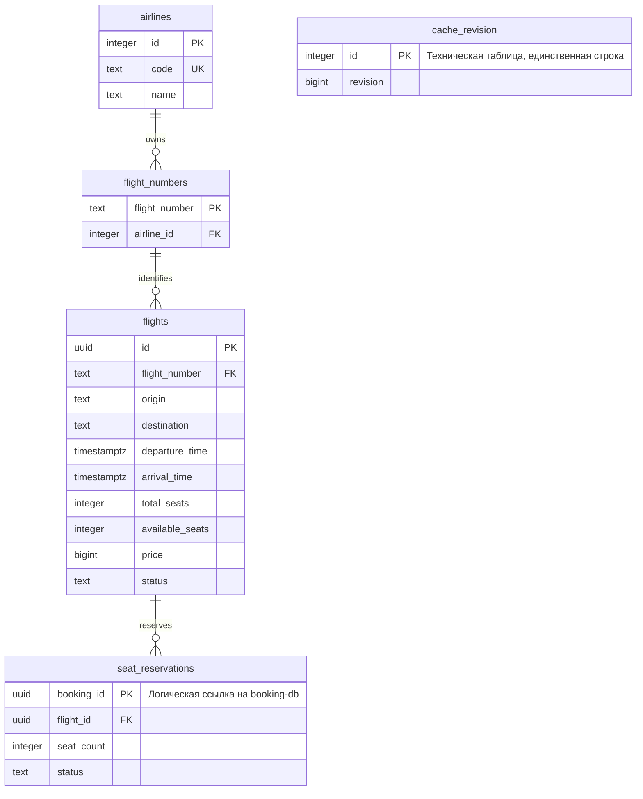
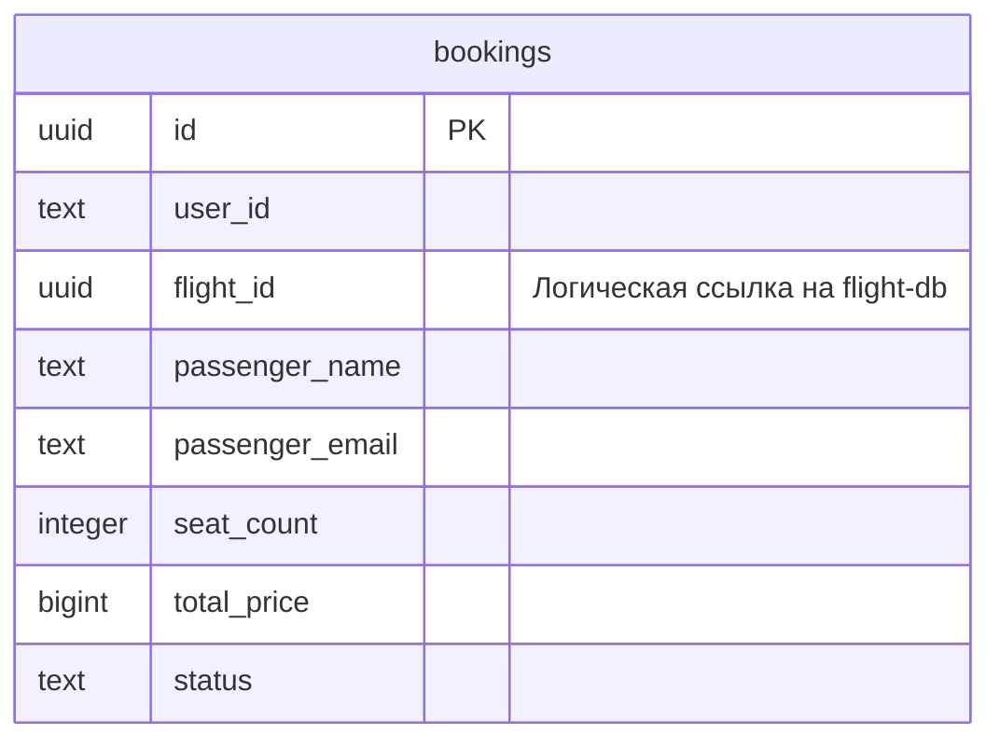

# ER-диаграммы

## Flight Service

## Booking Service

Схема соответствует 3NF: данные авиакомпаний и связь номера рейса с авиакомпанией вынесены в отдельные таблицы. Данные пассажира относятся к конкретному бронированию.

`bookings.flight_id` и `seat_reservations.booking_id` — логические ссылки между разными БД. Физические FK действуют внутри БД Flight Service. Пара номера рейса и UTC-даты вылета уникальна; ограничения целостности заданы в SQL-миграциях.
